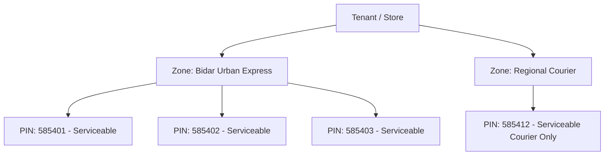
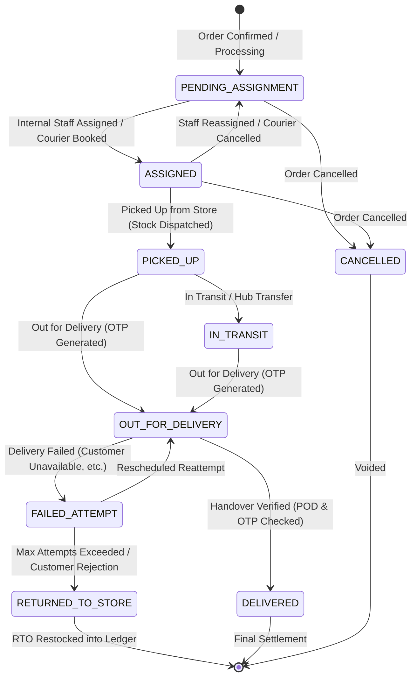

# Delivery, Logistics & Courier Operations Architecture

**Platform Owner:** TechMasters Innovations Private Limited  
**Merchant Scope:** Multi-tenant retail e-commerce platform (Initial merchant: Bagodi, Bidar, Karnataka)  
**Status:** Approved Specification  
**Version:** 1.0.0  

---

## 1. Executive Summary & Core Objectives

The **Delivery, Logistics & Courier Operations Engine** manages the physical fulfillment and transit lifecycle of customer orders. It provides a unified, multi-tenant fulfillment subsystem supporting two distinct delivery paradigms:

1. **Internal Fleet Delivery:** Merchant-employed delivery personnel (riders/drivers) and registered delivery vehicles operating within configured local delivery zones.
2. **Third-Party Courier Services:** Provider-independent integration with commercial logistics carriers (e.g., Delhivery, Shiprocket, Blue Dart) via an extensible Strategy Pattern adapter interface.

Both models adhere to a unified shipment lifecycle state machine, maintain immutable event-driven tracking histories, integrate with the authoritative Phase 4 inventory stock ledger, integrate with Phase 7 Cash on Delivery (COD) collection and reconciliation, and broadcast customer alerts via the Phase 8 transactional outbox.

---

## 2. Core Architectural Principles

1. **Provider Independence:** All third-party courier operations (booking, tracking, cancellation, label generation, webhook processing) are abstracted through the `BaseCourierProvider` interface. The core platform never binds to courier-specific APIs or payloads.
2. **Strict Multi-Tenancy & Store Scoping:** Delivery zones, personnel, vehicles, and shipments are strictly scoped by `tenant_id` and optionally `store_id`. No cross-tenant visibility or assignment is permitted.
3. **No Hardcoded Geographies:** Delivery zones and serviceability are fully configurable per merchant. No Bidar-specific coordinates or PIN codes are hardcoded into application logic.
4. **Authoritative State Transitions:** Shipment state transitions are enforced through an immutable validation matrix. Terminal states are irreversible.
5. **Double-Entry Inventory Cohesion:** Dispatch and Return-to-Origin (RTO) operations execute through Phase 4 `InventoryService` ledger transactions. Delivery operations never mutate stock balances directly.
6. **Unified COD Accounting:** When internal delivery staff collect cash upon delivery, the transaction routes directly into Phase 7 `PaymentService.record_cod_collection`. No redundant COD ledger or settlement tables are created.
7. **Transactional Outbox Eventing:** State transitions atomically enqueue customer communication events (`shipment.created`, `shipment.out_for_delivery`, `shipment.delivered`, `shipment.failed_attempt`, `shipment.rto`) into the `notification_outbox`.
8. **Delivery OTP & POD Integrity:** Handover verification is guarded by a cryptographically random, rate-limited Delivery OTP and structured Proof of Delivery (POD) record.

---

## 3. Delivery Zones & Dynamic Serviceability

### 3.1 Zone and Coverage Hierarchy

Merchants configure delivery operations into zones:
- **`DeliveryZone`**: Represents an operational delivery territory for a tenant (e.g., "City Center Express", "District Standard", "Outstation Courier").
  - Configurable attributes: base delivery charge, free delivery threshold, estimated transit hours, internal fleet support flag, courier support flag, and COD availability flag.
- **`DeliveryZonePincode`**: Maps specific postal PIN codes to a zone.
  - Allows granular serviceability toggling and per-PIN delivery charge overrides.



### 3.2 Serviceability Resolution Algorithm

When a customer or checkout requests a serviceability check for destination PIN code `P`, order subtotal `S`, and shipment weight `W`:
1. Search active `DeliveryZonePincode` entries for `tenant_id` matching `P`.
2. If no record is found or `is_serviceable` is False:
   - Return `{ serviceable: false, reason: "PIN_CODE_NOT_SERVICEABLE" }`.
3. Resolve associated `DeliveryZone`:
   - Determine available delivery modes (`internal`, `courier`).
   - Calculate delivery charge:
     - If `free_delivery_threshold` is configured and `S >= free_delivery_threshold`: charge = `0.00`.
     - Else if `delivery_charge_override` is set on the PIN code: charge = `delivery_charge_override`.
     - Else: charge = zone `base_delivery_fee`.
   - Return serviceability details including estimated delivery timeframe, supported payment methods (COD eligibility), and available delivery modes.

---

## 4. Internal Fleet & Vehicle Management

### 4.1 Delivery Personnel (`DeliveryPersonnel`)
- Links to an authenticated platform `User` with delivery staff permissions (`delivery:staff`).
- Tracked fields: `employee_code`, `full_name`, `phone_number`, `driving_license_number`, `verification_status` (`PENDING`, `VERIFIED`, `REJECTED`), `duty_status` (`AVAILABLE`, `ON_DELIVERY`, `OFFLINE`), `current_latitude`, `current_longitude`, and `last_active_at`.
- Strict validation: Only personnel with `verification_status == VERIFIED` and `is_active == True` can be assigned shipments.

### 4.2 Delivery Vehicles (`DeliveryVehicle`)
- Fleet assets: `vehicle_type` (`BICYCLE`, `MOTORCYCLE`, `SCOOTER`, `VAN`, `TRUCK`), `registration_number`, `max_weight_capacity_kg`, `max_volume_capacity_m3`, and `status` (`AVAILABLE`, `IN_USE`, `MAINTENANCE`, `INACTIVE`).
- Capacity checks: When assigning a shipment to a vehicle, the shipment's `total_weight_kg` must not exceed `max_weight_capacity_kg`.

---

## 5. Shipment Lifecycle State Machine

Shipments undergo deterministic lifecycle state transitions:



### 5.1 Permitted Status Transitions Matrix

| Current Status | Allowed Target Statuses | Inventory & Domain Actions |
|---|---|---|
| `PENDING_ASSIGNMENT` | `ASSIGNED`, `CANCELLED` | Validates store and order status |
| `ASSIGNED` | `PICKED_UP`, `PENDING_ASSIGNMENT`, `CANCELLED` | On unassign: releases personnel |
| `PICKED_UP` | `IN_TRANSIT`, `OUT_FOR_DELIVERY` | Triggers Phase 4 `dispatch_stock` if order not yet dispatched |
| `IN_TRANSIT` | `OUT_FOR_DELIVERY`, `FAILED_ATTEMPT` | Hub scans, route tracking |
| `OUT_FOR_DELIVERY` | `DELIVERED`, `FAILED_ATTEMPT` | Generates 6-digit Delivery OTP; alerts customer |
| `FAILED_ATTEMPT` | `OUT_FOR_DELIVERY`, `RETURNED_TO_STORE` | Increments attempt counter; schedules next attempt date |
| `RETURNED_TO_STORE` | None (Terminal) | Compensating ledger return inward via `InventoryService` |
| `DELIVERED` | None (Terminal) | POD persisted; COD collected; order status set to `DELIVERED` |
| `CANCELLED` | None (Terminal) | Frees assigned staff/vehicle |

---

## 6. Provider-Independent Courier Interface

Logistics providers adhere to the `BaseCourierProvider` abstract interface:

```python
class BaseCourierProvider(ABC):
    @abstractmethod
    async def book_shipment(self, request: CourierBookingRequest) -> CourierBookingResult:
        """Create a commercial booking and obtain AWB and shipping label."""

    @abstractmethod
    async def track_shipment(self, tracking_number: str) -> CourierTrackingResult:
        """Fetch latest tracking checkpoints from carrier."""

    @abstractmethod
    async def cancel_shipment(self, tracking_number: str) -> CourierCancelResult:
        """Cancel an existing carrier consignment."""

    @abstractmethod
    async def generate_label(self, tracking_number: str) -> CourierLabelResult:
        """Obtain printable shipping label URL or PDF."""

    @abstractmethod
    def verify_webhook_signature(self, raw_body: bytes, headers: dict[str, str]) -> bool:
        """Cryptographically verify authenticity of carrier webhook payload."""

    @abstractmethod
    def parse_webhook_payload(self, raw_body: bytes, headers: dict[str, str]) -> CourierWebhookPayload:
        """Normalize carrier-specific webhook payload into platform schema."""
```

### 6.1 Mock Carrier Adapter (`MockCourierProvider`)
Provides a contract-compliant reference implementation:
- Predictable AWB allocation (`BAGODI-MOCK-<uuid>`).
- HMAC-SHA256 webhook signature validation using configurable secret `COURIER_WEBHOOK_SECRET`.
- Simulated checkpoint progression without external network dependencies.

---

## 7. Proof of Delivery (POD) & Doorstep Verification

### 7.1 Delivery OTP Workflow
1. When a shipment transitions to `OUT_FOR_DELIVERY`, `DeliveryService` generates a 6-digit numeric OTP (valid for 24 hours).
2. The OTP is communicated to the customer via SMS/WhatsApp via the Phase 8 transactional outbox (`shipment.out_for_delivery`).
3. Delivery staff must supply the OTP at delivery completion:
   - Failed attempts increment `delivery_otp_attempts`.
   - Max 5 failed attempts locks OTP verification to prevent brute-force attacks.

### 7.2 Proof of Delivery Record (`ProofOfDelivery`)
Upon verified delivery, an immutable POD record stores:
- `recipient_name`: Full name of person receiving package.
- `recipient_phone`: Phone number of recipient.
- `relationship_to_customer`: `SELF`, `FAMILY`, `NEIGHBOR`, `SECURITY`, `COLLEAGUE`, `OTHER`.
- `delivered_at`: Authoritative UTC timestamp.
- `delivery_otp_verified`: Boolean flag confirming OTP match.
- `signature_url`: Optional signed customer signature asset.
- `photo_url`: Optional doorstep handover photograph.
- `notes`: Operational remarks.

---

## 8. Financial & Inventory Reconciliation

### 8.1 Cash on Delivery (COD) Integration
- For COD orders (`payment_method == "cod"` and `is_cod == True`):
  - Handover requires the recipient to pay the `cod_amount`.
  - `DeliveryService.complete_delivery` invokes `PaymentService.record_cod_collection(...)`.
  - A `CodSettlement` record is created in Phase 7 with `collected_by_name` set to the delivery executive.
  - The order payment status is updated to `captured`.

### 8.2 Inventory Restocking on Return-to-Origin (RTO)
- If delivery fails repeatedly (reaching `max_delivery_attempts`) or the customer rejects the parcel at the door:
  - The shipment transitions to `RETURNED_TO_STORE`.
  - The platform initiates compensating inventory transactions:
    - If items were physically dispatched from the store (`Order.fulfillment_status == "fulfilled"`), `InventoryService.return_customer_stock(...)` posts a return inward transaction to the store's inventory ledger.
    - If the items never left the store, reservations are safely released.
  - The order status transitions to `RETURNED` or `CANCELLED`.

---

## 9. Notification & Audit Integration

### 9.1 Transactional Outbox Events
All shipment lifecycle events persist to `notification_outbox` in the same database transaction:
- `shipment.created`: Notifies customer of shipment preparation.
- `shipment.assigned`: Notifies customer of courier AWB or assigned delivery executive.
- `shipment.out_for_delivery`: Sends real-time delivery alert with Delivery OTP.
- `shipment.delivered`: Sends delivery confirmation and digital receipt.
- `shipment.failed_attempt`: Informs customer of failed attempt, failure reason, and scheduled reattempt date.
- `shipment.rto`: Informs customer and merchant of return-to-store initiation.

### 9.2 Audit Logging
Every operational action writes an immutable record to `delivery_audit_logs`:
- `tenant_id`, `shipment_id`, `actor_id`, `action`, `from_status`, `to_status`, `payload`, `created_at`.

